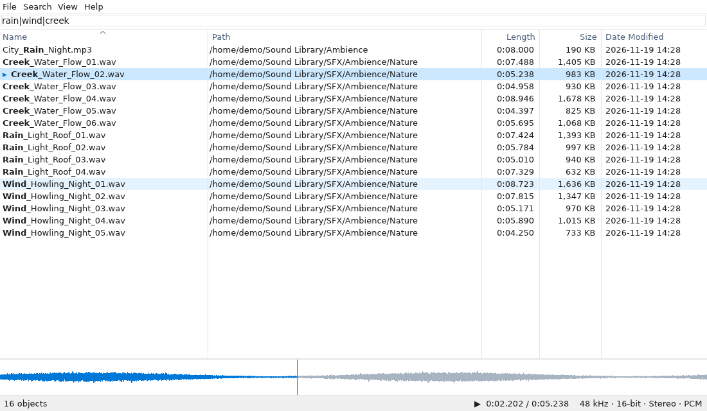

# Totems

Instant search and preview for every audio file on your machine.

A lightweight, keyboard-first window: one search box, one result list, a waveform strip and a
status bar. The list scrolls in whole rows, so the top row always sits fully under the column
headings. It does two things, search and playback, and is built to be as fast as possible at both.



## Search

- **Indexes every audio file** on your local drives (Windows: every drive; macOS/Linux: home
  plus mounted volumes). WAV/BWF/RF64, AIFF, FLAC, MP3, OGG, Opus, M4A/AAC/ALAC, CAF, WMA, APE,
  WavPack and more. WAVs that hold MP3 data (some sampler packs), RF64/BW64 recordings, and WAVs
  a crashed recorder left with zero sizes in their header play too. Configure
  folders under **File › Folders…**. macOS metadata files
  (`._Kick.wav`, `__MACOSX` folders) are never indexed; they aren't audio.
- **Bookmarks** (**File › Bookmarks…**): folders you jump to with **Ctrl+1 … Ctrl+0**. The
  key fills the search box with the folder (quoted, caret at the end), so the list shows only
  files in it and its subfolders, and whatever you type next narrows that down. New bookmarks
  take the lowest free key; click a bookmark's key square to change it (a key belongs to one
  bookmark). Same cost as any search: a folder plus a word takes about 1.4 ms over 1M files.
- **Results update on every keystroke.** Names live in packed, pre-sorted buffers that are
  scanned in parallel with SIMD substring search. With 1,000,000 files on a 4-core machine, a
  typical query takes 0.3–5 ms, and the slowest (regex) takes about 35 ms.
- **Instant startup.** The finished index is cached on disk: 1M files load in about 100 ms. A
  background rescan then refreshes it, and a file-system watcher keeps it live as files are added,
  deleted, renamed or moved. Live updates never scroll the list away from where you are.
- **Sorting is free.** Rank tables for Name / Path / Size / Date Modified are precomputed, so
  re-sorting a million results is a single integer sort.

### Syntax

| Query | Meaning |
|---|---|
| `door slam` | both words (AND) |
| `whoosh \| swish` | either (OR, binds tighter than AND) |
| `!loop` | exclude |
| `<rain \| wind> !city` | grouping |
| `"door slam"` | exact phrase |
| `*.wav`  `kick_??` | wildcards, matched against the whole name |
| `foley\door` | a term with a path separator matches the full path |
| `F:\Samples\Vol. 1\(03).wav` | a query starting with a drive or `\\server` is one literal path, so a pasted path (Ctrl+C, or Explorer's Copy as path) finds its file |
| `ext:wav;flac` | extensions |
| `size:>2mb`  `size:1mb..5mb`  `size:huge` | size filters |
| `case:` `path:` `regex:` `nocase:` `nopath:` | per-term modifiers |

**Search** menu: Match Case, Match Path, Enable Regex (the whole query becomes one regex).

## Playback

- **Select it and you hear it.** Arrow keys, Page Up/Down and clicks play the selected file
  immediately. A decoder thread streams into a lock-free ring buffer. On a switch, the audio
  callback fades the old sound out over 5 ms and starts the new one on the next sample, with no
  handshake. Key-to-sound latency is one audio buffer (about 10 ms), and the first audio is ready
  0.04–2.6 ms after the file opens. Turn this off under **Playback › Autoplay on Select**; then
  Enter, Space or double-click plays the selected file.
- **Autoplay Next** (Playback menu): when a file plays to its end, the next row is selected
  and played, so you can listen down a list hands-free. Esc stops it; files that won't play are
  skipped (it gives up after 20 in a row). An auditioned waveform selection doesn't move on.
- **Loop** (Playback menu): the file, or the waveform selection, repeats with no gap; the
  playhead and time wrap back each pass. Plain loops are sample-exact, for sounds made to
  loop. **Crossfade Loop** blends the last 10 ms of each pass into the start of the next
  (equal power), so material that wasn't made to loop doesn't click. Loop wins over Autoplay
  Next. Passes under 1 ms play once.
- **Bit-exact** when the file's sample rate matches the device. Otherwise a 24-zero-crossing
  Kaiser-windowed sinc resampler is used, which is transparent and has no aliasing.
  Mono plays to both ears, and 5.1 and other multichannel files are folded down properly.
  Files whose header claims a sample rate below 1 kHz or above 1,536 kHz are refused
  ("Unsupported sample rate") rather than resampled.
- **Click-free** fades on stop, pause, seek and switch. A sound's own attack is never softened
  when it starts.
- **Follows the output device:** unplug the headphones or interface and playback carries on
  from the same spot on the new default device (paused stays paused).
- **Waveform strip** for the selected file, drawn as it decodes:
  - **Click** to move the playhead there. Playback continues from that point, or starts there
    if stopped. If paused, it stays paused at the new spot. The wave is inset from the left
    edge; a click in that gap goes to 0:00.
  - **Left-drag** to select a range. On release, just that range plays and stops at its end
    with a 5 ms fade. Enter or Space replays the range, and Esc clears it. The selection's edges
    carry small white crowns, and only the selected part of the wave stays coloured.
  - **Right-drag** to scrub. The selection is kept.
  - **Drag its top edge** to make the strip taller or shorter (32–400 px); the height is kept
    between runs.
  - **Drag from inside the selection** (Windows) to drop that range as its own WAV. The file is
    sample-exact and keeps the source's sample rate, channels and bit depth: 16/24-bit and
    32-bit float stay as they are, and MP3/AAC/OGG become 24-bit WAV. It's named like
    `Door_Slam_01 [0.512-1.734].wav`.
- **Volume** slider in the status bar, from +12 dB down to −∞ in 0.5 dB steps. It glides over
  about 10 ms so moving it never clicks, and output stays bit-exact at 0 dB. Double-click resets
  to 0 dB, and each mouse-wheel notch moves it 0.5 dB. Right-click chooses what happens when boosting
  overloads: **Soft clip** (the default: a smooth knee from −1 dBFS that never exceeds full scale)
  or **Hard clip** (like a DAW fader).
- **Drag out** (Windows): drag any row onto the desktop, a folder, a DAW timeline or an email to
  drop a copy of the file there. The original is never moved. Exported selections are temporary
  (`%LOCALAPPDATA%\Totems\Regions`). They're deleted when Totems exits and again at the next
  launch, so copy anything you want to keep into your project. Files under two minutes old are
  kept so that a background Explorer copy can finish, and files a program still has open are
  retried next time.
- **Length** column and format readout (rate, bit depth, channels, codec). Only visible rows are
  probed, newest first.

### Keys

| Key | Action |
|---|---|
| type | search (the search box always has the caret) |
| ↑ ↓ PgUp PgDn, Ctrl+Home/End | move selection and play (if Autoplay is on) |
| Ctrl+↑ | jump to the top of the list |
| Ctrl+↓ | jump to the next file with a different name (skips a run of identical names) |
| Enter, double-click | play from start (or the waveform selection); double-clicking a new row plays it once, without a restart |
| Space | play / pause (after navigating) |
| ← → (Shift) | seek 1 s (5 s); after Esc, starts the selected file there |
| Ctrl+← | back to the start of the selected file, from the list or the search box (stays paused if paused) |
| Esc | stop, then clear the waveform selection |
| Tab | toggle between search and list |
| Ctrl+F | back to search, select query |
| Ctrl+1 … Ctrl+0 | search a bookmarked folder (File › Bookmarks…) |
| Ctrl+C | copy full path of selected file (the status bar confirms) |
| Ctrl+click a Path cell | open that folder in Explorer, with the file selected |
| right-click a Path cell | copy the folder path (the status bar confirms) |
| click ▶ in the status bar | go back to the playing file (selects it and scrolls to it) |
| drag a row out | copy the file to wherever it's dropped (Windows) |
| click waveform | move the playhead |
| left-drag waveform | select a range and audition it |
| drag from inside the selection | drop the range as a WAV (Windows) |
| right-drag waveform | scrub |
| drag waveform top edge | make the waveform taller or shorter |

## Build

```sh
cargo build --release          # target/release/totems(.exe)
```

Single native binary (Rust, egui, symphonia, cpal). Linux needs ALSA headers
(`libasound2-dev`) to build. To cross-build for Windows from Linux:

```sh
rustup target add x86_64-pc-windows-gnu
cargo build --release --target x86_64-pc-windows-gnu
```

Tests: `cargo test --release`. Benchmarks and tools (ignored by default):

```sh
cargo test --release bench_1m -- --ignored --nocapture                     # 1M-file search
TOTEMS_AUDIO_DIR=~/sfx cargo test --release decode_dir -- --ignored --nocapture
TOTEMS_SCAN=/ cargo test --release scan_root -- --ignored --nocapture
```
